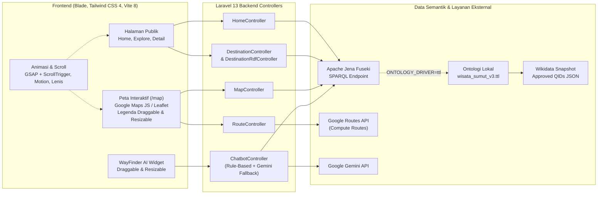

<div align="center">


<a href="https://git.io/typing-svg">
  
</a>

<br />

[](https://laravel.com/)
[](https://www.php.net/)
[](database/ontology/wisata_sumut_v3.ttl)
[](docs/SETUP-FUSEKI.md)
[](https://developers.google.com/maps)
[](https://ai.google.dev/)
[](https://tailwindcss.com/)
[](https://gsap.com/)
[](https://motion.dev/)
[](https://lenis.darkroom.engineering/)

</div>

---

## Ringkasan Fitur Utama Proyek

**WayFinder** adalah platform panduan wisata Sumatera Utara berbasis **Web Semantik (RDF/SPARQL)** dan **Hybrid AI** yang dibangun menggunakan Laravel 13, Vite 8, serta antarmuka interaktif modern.

| Pilar Fitur | Deskripsi & Kemampuan Terbaru |
| :--- | :--- |
| **Knowledge Graph & Ontologi Pariwisata** (`wisata_sumut_v3.ttl`) | Pemodelan semantik **304+ destinasi** di kabupaten/kota Sumatera Utara lengkap dengan relasi kategori (`Alam`, `Budaya`, `Religi`, `Bahari`, `Kuliner`, `Buatan`), fasilitas, aktivitas, jadwal buka, kontak, harga tiket, metadata **RDFa / Open Graph**, **RDF Exporter** (`Turtle`, `RDF/XML`, `JSON-LD`), serta integrasi **Linked Data Wikidata** melalui snapshot terkurasi. |
| **Peta Eksplorasi Interaktif & In-App Route Planner** | Visualisasi peta berbasis **Google Maps JavaScript API** (dengan fallback **Leaflet**), marker kustom per kategori, *Marker Clustering*, kartu *InfoWindow* berisi foto, rating, dan harga tiket, panel **Legenda Peta** yang dapat digeser (*draggable*) & diubah ukurannya (*resizable*), serta **Perencana Rute Perjalanan (`POST /routes/compute`)** langsung di dalam aplikasi (GPS *Lokasi Anda*, pemilihan mode perjalanan, rute alternatif, dan panduan belokan). |
| **WayFinder AI (Hybrid Chatbot Engine)** | Arsitektur hibrida yang memadukan **Local Rule-Based Ontology Engine** (jawaban cepat dan presisi langsung dari dataset untuk pencarian, filter, dan rekomendasi) dengan **Gemini AI API Fallback** untuk pertanyaan naratif kompleks, dilengkapi jendela asisten mini yang dapat digeser (*draggable*), diubah ukurannya (*resizable* dari pojok kiri atas), mode layar penuh, serta terhubung dengan peta. |
| **Pencarian Semantik & Filter Langsung** | Pencarian berbobot lintas nama, wilayah, alamat, deskripsi, petunjuk, kata kunci, fasilitas, dan aktivitas; dilengkapi *live suggestions*, pembaruan hasil dinamis tanpa reload, koreksi ejaan otomatis (*typo tolerance*), dan parameter `exact=1` untuk pencocokan persis. |
| **Modern UI/UX & Micro-Interactions** | *Smooth scrolling* menggunakan **Lenis** (otomatis dinonaktifkan di halaman `/map` full-viewport serta mengecualikan area scroll internal lewat `data-lenis-prevent`), animasi judul per kata dan kemunculan bertahap dengan **GSAP + ScrollTrigger**, animasi kartu masuk & hover dengan **Motion**, dukungan *prefers-reduced-motion*, serta toggle **Mode Gelap/Terang**. |

---

## Arsitektur Sistem



---

## Dokumentasi & Konfigurasi Detail

<details>
<summary><strong>Detail 1: Struktur File, Arsitektur Ontologi & Perintah Artisan</strong></summary>

### Struktur Data Utama
- `database/ontology/wisata_sumut_v3.ttl` — Graph ontologi utama v3 dalam format Turtle (dipakai runtime lokal dan pemuatan Fuseki via `ONTOLOGY_V3_TTL_PATH`).
- `database/ontology/wisata_sumut_v2.ttl` — Sumber migrasi v2 (hanya sebagai sumber migrasi; tidak ditimpa saat pemuatan).
- `database/ontology/external/wikidata-wilayah.json` — Daftar QID dan pasangan batas wilayah yang disetujui.
- `database/ontology/external/wikidata-wilayah-detail.json` — Snapshot detail wilayah hasil verifikasi Wikidata.
- `database/ontology/external/wikidata-destinasi-tautan.json` — Daftar persetujuan (`setuju`/`tolak`) serta kandidat tautan destinasi Wikidata.
- `database/ontology/external/wikidata-destinasi-detail.json` — Snapshot detail destinasi khusus QID yang telah disetujui.
- `config/ontology.php` — Konfigurasi driver ontologi (`fuseki` atau `ttl`), cache TTL, dan kredensial Fuseki.

### Perintah Artisan Ontologi & Fuseki
```bash
# Validasi skema dan isi data ontologi v3
php artisan ontology:validate

# Memanaskan cache ontologi untuk halaman publik dan chatbot
php artisan ontology:warm

# Mendiagnosis konsistensi antara file Turtle, Fuseki, cache, dan snapshot Wikidata
php artisan ontology:doctor

# Menguji konektivitas Wikidata secara eksplisit
php artisan ontology:doctor --eksternal

# Memeriksa rencana unggah ke Fuseki tanpa mengubah dataset (dry-run)
php artisan fuseki:load --dry-run

# Mengunggah ontologi v3 ke dataset Apache Jena Fuseki (membuat backup otomatis)
php artisan fuseki:load

# Memperbarui snapshot wilayah & destinasi Wikidata yang sudah disetujui
php artisan wikidata:refresh
```

</details>

<details>
<summary><strong>Detail 2: Panduan Instalasi & Konfigurasi <code>.env</code></strong></summary>

### Prasyarat Lingkungan
- **PHP 8.4+** dengan ekstensi `pdo_mysql` dan **Composer**
- **Node.js** (`^20.19` atau `>=22.12`) dan **npm**
- **MySQL** (untuk session, cache, dan queue)
- **Apache Jena Fuseki** (opsional jika menggunakan `ONTOLOGY_DRIVER=ttl`)

### Langkah Instalasi Cepat
1. **Clone repositori dan masuk ke direktori proyek:**
   ```bash
   git clone <url-repository>
   cd WS-TUBES-KLMPK5
   ```
2. **Jalankan skrip setup otomatis (atau jalankan langkah manual di bawah):**
   ```bash
   composer run setup
   ```
3. **Atau instalasi secara manual:**
   ```bash
   composer install
   npm install
   cp .env.example .env
   php artisan key:generate
   php artisan migrate
   ```
4. **Konfigurasi variabel penting pada `.env`:**
   ```env
   # Database MySQL
   DB_CONNECTION=mysql
   DB_HOST=127.0.0.1
   DB_PORT=3306
   DB_DATABASE=wayfinder
   DB_USERNAME=root
   DB_PASSWORD=

   # Driver Ontologi: 'fuseki' (default) atau 'ttl' (file Turtle lokal tanpa Fuseki)
   ONTOLOGY_DRIVER=fuseki
   ONTOLOGY_V3_TTL_PATH=database/ontology/wisata_sumut_v3.ttl
   FUSEKI_URL=http://localhost:3030
   FUSEKI_DATASET=WayFinder

   # Google Maps & Routes API (batasi via HTTP referrer di Google Cloud Console)
   GOOGLE_MAPS_API_KEY=

   # Gemini AI API (opsional, khusus server-side untuk fallback chatbot)
   GEMINI_API_KEY=
   GEMINI_MODEL=gemini-3.5-flash-lite
   ```
5. **Jalankan server pengembangan:**
   ```bash
   # Terminal 1: Laravel backend
   php artisan serve

   # Terminal 2: Vite frontend hot-reload
   npm run dev
   ```
   Untuk build produksi, jalankan `npm run build`.

</details>

<details>
<summary><strong>Detail 3: Daftar Endpoint Utama Aplikasi</strong></summary>

| Metode | Path | Nama Route | Controller | Fungsi |
| :--- | :--- | :--- | :--- | :--- |
| `GET` | `/` | `home` | `HomeController@index` | Beranda ringkasan ontologi, kategori, dan destinasi unggulan |
| `GET` | `/destinations` | `destinations` | `DestinationController@index` | Daftar destinasi dengan pencarian semantik, filter, dan paginasi |
| `GET` | `/destinations/live` | `destinations.live` | `DestinationController@live` | Pembaruan daftar destinasi dan statistik secara dinamis (AJAX) |
| `GET` | `/destinations/suggest` | `destinations.suggest` | `DestinationController@suggest` | Saran pencarian otomatis (*live autocomplete*) |
| `GET` | `/destinations/{id}` | `destination.detail` | `DestinationController@show` | Halaman detail destinasi (`ws-001`..`ws-xxx`) dengan metadata RDFa & OGP |
| `GET` | `/destinations/{id}/rdf.{format}` | `destination.rdf` | `DestinationRdfController` | Ekspor graph RDF destinasi (`ttl`, `rdf`, `jsonld`) |
| `GET` | `/map` | `map` | `MapController@index` | Peta interaktif Google Maps / Leaflet beserta legenda & panel rute |
| `GET` | `/map/live` | `map.live` | `MapController@live` | Pembaruan marker & daftar destinasi peta secara dinamis (JSON/HTML) |
| `POST` | `/routes/compute` | `routes.compute` | `RouteController@compute` | Kalkulasi rute perjalanan melalui Google Routes API |
| `POST` | `/chatbot/send` | `chatbot.send` | `ChatbotController@chat` | Endpoint pesan WayFinder AI (Rule-Based Ontology + Gemini Fallback) |

</details>

<details>
<summary><strong>Detail 4: Dokumentasi Teknis & Pengujian</strong></summary>

- [Arsitektur Aplikasi](docs/ARSITEKTUR.md)
- [Fitur Pencarian & Koreksi Ejaan](docs/fitur-pencarian.md)
- [Panduan Setup Apache Jena Fuseki](docs/SETUP-FUSEKI.md)
- [Sumber Eksternal & Lisensi Wikidata](docs/sumber-eksternal.md)
- [Validasi RDFa & Open Graph](docs/validasi-rdfa-ogp.md)
- [Bukti Kueri SPARQL](docs/bukti-sparql.md)
- [Smoke Test Manual](docs/SMOKE-TEST.md)

Menjalankan suite pengujian Laravel:
```bash
php artisan test
```

</details>

---

<div align="center">

### Tim Pengembang

**Kelompok 5 — Mata Kuliah Web Semantik**<br />
Program Studi **S1 Teknologi Informasi**<br />
Fakultas Ilmu Komputer dan Teknologi Informasi<br />
**Universitas Sumatera Utara**

<br />


</div>
